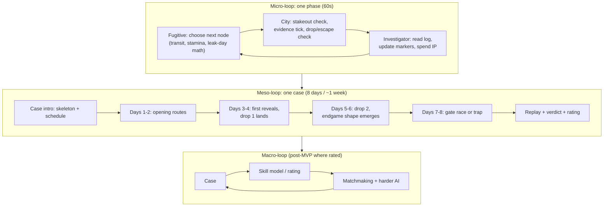

# 02 — Game Design Document (GDD)

**Version:** 1.0-rc1 · Defers to 03-rules.md wherever mechanics are normative.

## 1. Design pillars

1. **The map always tells the truth.** No RNG decides captures; evidence never lies; scheduled reveals fire exactly when published. All uncertainty is epistemic (you don't know), never aleatory (the game cheated). Every loss must be explainable in the post-case replay.
2. **Two minds, one city.** Asymmetry with identity: the Fugitive is a planner playing against a *calendar* they can see; the Investigator is a reader playing against a *person* they cannot see. Neither role is a watered-down mirror of the other.
3. **Your move fits in a coffee break.** One phase = one crisp decision (≤ 60 seconds of interaction). The game's real-time rhythm is days, not minutes. No session ever demands more than one decision to stay alive.
4. **Mastery is visible.** Skill expresses itself in measurable ways: markers that match the truth, probes that ask questions whose answers change plans, stakeouts placed where belief meets budget. Ratings per role; replays that show the "why."

## 2. The two fantasies

**Investigator — "reader of the city."** You hold a dossier: a public skeleton (two drop sites, a gate, a leak calendar) and a budget (10 IP). Each day the city gives you a scheduled crumb (district on days 3 & 6, transit class on day 4) and you buy more with probes. The pleasure is *narrative reconstruction*: "They took the tram after the Harbor drop — nobody takes the tram to Old Town unless they're heading for the Rail Yard gate." The climax is the stakeout: converting belief into a single predicted node, knowing a miss burns 3 IP and a day.

**Fugitive — "ghost with an itinerary."** You know exactly which days leak which information. Your job is to route two ordered drops and an exit while giving the calendar as little truth as possible: cross district lines right *after* a reveal, arrive at drops early, take a Metro spine the day before a transit reveal, Hold to break day-parity. The pleasure is *planning under publication*: you always know what the city will say about you and when.

**The tension engine:** both players share the same public schedule. The Fugitive plans *around* it; the Investigator reads *through* it. Every reveal day is a heartbeat both feel.

## 3. Loops

Meso-loop emotional curve (design intent, to be validated in M4 playtests): curiosity (D1–2) → first "I know where you went" spike (D3–4) → dread/endgame (D5–8) → replay catharsis. The replay is mandatory content: every case ends by *showing the story*.

## 4. What a case is

- **8 days.** Two public ordered **drop sites** (of 16 candidates), one public **exit gate** (of 2), one public **safehouse start** (of 2). Generated per case, BFS-verified feasible (minimal completion ∈ [5,7] days) — see 04-balance-sim §6.
- **Fugitive resources:** 12 Stamina; Foot=1, Tram=2, Metro=3, Hold=1 (max 2 Holds/case). One move per day (one graph edge).
- **Investigator resources:** 10 IP; Probe=1 (≤2/day), Stakeout=3 (≤1/day, never on Day 8), arms exactly the next day.
- **Public schedule:** district of the Fugitive's end position revealed at end of Days 3 and 6; transit class of the Day-4 move revealed at end of Day 4; drop completions public when they happen.
- **Verdicts:** Escape (F wins), Stakeout capture (I wins), Day-8 expiry without escape (I wins). No draws; mutual abandonment voids the case.

Content model: a case is a **parameter set on one map**, not authored content. Flavor is generated (dossier title/one-liner) and never mechanical.

## 5. Difficulty philosophy

- **Fair first:** every information channel is deterministic and published. The game neverwithholds rules; the *fog* is the Fugitive, not the manual.
- **Depth via decisions, not parameters:** mastery = better questions (probes), better calendar-reading (reveals), better risk pricing (when 3 IP for a stakeout beats 3 probes).
- **Solo assists are honest:** the assist heatmap and reveal upgrades are labeled assists, exist only in solo, and are part of the adaptive knob set. Ranked is frozen, seeded, and identical for everyone (00-audit A8).
- **Losing teaches:** every case ends with a replay overlay (true route vs. probes vs. stakeouts vs. reveals). The post-case "what you missed" beat is the retention mechanic — design intent: players should lose to *ideas*, and be shown the idea.

## 6. Onboarding design intent

Two scripted cases ("The Vermeer Slip" set): as Investigator, the AI Fugitive makes one visible mistake (travels on a reveal-adjacent day); as Fugitive, the AI Investigator probes greedily and wastes its stakeout. Tooltips teach markers, the schedule, and budget math *at the moment of relevance*. The tutorial cannot be forfeited, cannot hurt ratings, and can be skipped by experienced players (hidden behind a settings toggle after first completion).

## 7. Accessibility & inclusivity intent

District identity is never color-only (icon + label + color). One-hand reach: actions bottom-sheet, map upper. Deadlines in local time. No reaction-time skill. Language: MVP English; string externalization from day one (06-uiux §6).

## 8. Monetization philosophy (M7; principles fixed now)

1. **The firewall:** purchases and ads exist in solo/casual only; ranked cases are forever untouched by money.
2. **Player-favor adaptation only:** assists, continues, cosmetics — never information asymmetry against a human opponent, never random paid items.
3. **Ads at genuine decision points:** solo "continue after loss," casual "+1 probe," both opt-in and capped (≤3/day).
4. **Transparency:** adaptive solo modes are disclosed as adaptive; the ranked engine is seed-frozen and auditable from the case ID.
