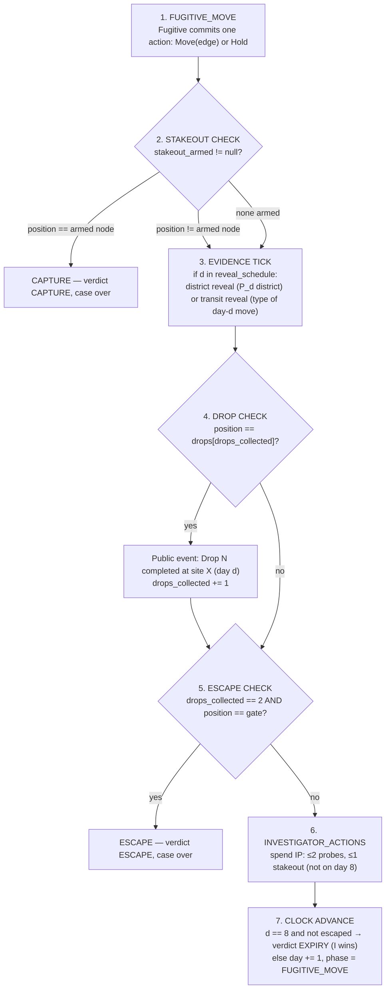

# 03 — Complete Ruleset v1.0-alpha ("Alpha Rules")

**Status:** normative. This document is the single source of truth for game rules. The engine (future implementation) and the simulation harness must implement exactly this text. Parameter values live in 04-balance-sim §3 (currently `v1.0-alpha` values, reproduced here for readability); changing a value requires updating both and bumping `ruleset_version`.

**Determinism guarantee:** given a case configuration and a legal action sequence, the full case outcome is a pure function. There is no RNG in resolution. The only randomness in Dead Drop is *which case the generator deals* (seeded, recorded).

---

## 1. Components and state model

### 1.1 The city (map)

A map is a weighted undirected graph `G = (V, E)`:

- `V`: locations ("nodes"), each with: `node_id`, `district` (one of 4), `is_gate`, `is_safehouse`, `is_drop_candidate`.
- `E`: connections, each with exactly one transit **class**: `Foot` (F), `Tram` (T), `Metro` (M).
- Movement is **one edge per day** — every move, regardless of class, takes exactly one day. Classes differ in stamina cost and evidence exposure (§4), not in speed.

**map_alpha v1.1 [computed]:** 48 nodes (4 districts × 12), 84 edges (56 F, 16 T, 12 M), connected, node degree 2–7. Canonical data: `assets/sample_map_alpha.json`. Node id format: `D{district}-{ring position 01..12}`.

### 1.2 Case configuration (generated per case, public unless marked)

| Field | Type | Visibility |
|---|---|---|
| `map_id`, `ruleset_version` | string | public |
| `safehouse` | node | **public** (Fugitive's start) |
| `drops[2]` | ordered nodes (drop candidates) | **public** (order matters) |
| `gate` | node | **public** |
| `stamina_budget` | int (default 12) | public |
| `intel_budget` | int (default 10) | public |
| `reveal_schedule` | {district_days: [3,6], transit_days: [4]} | public |
| `seed` | int | recorded; case is reproducible |

### 1.3 Dynamic state

```
CaseState {
  day: 1..8
  phase: FUGITIVE_MOVE | RESOLVING | INVESTIGATOR_ACTIONS | CASE_OVER
  fugitive: { position: node (HIDDEN from Investigator until case end),
              stamina: int, holds_used: int, drops_collected: 0..2 }
  investigator: { intel: int, probes_today: 0..2, stakeout_armed: node | null }
  log: [ public events ]          // reveals, drop completions, day markers
  private_log_investigator: [ probe results, stakeout results ]
  verdict: null | ESCAPE | CAPTURE | EXPIRY | FORFEIT_F | FORFEIT_I | VOID
}
```

**Hidden vs. public (exhaustive list).** *Hidden from Investigator during play:* Fugitive's position, route history, remaining stamina, holds used, drops collected (except when a completion event fires). *Hidden from Fugitive during play:* all probe placements and results, all stakeout placements and results, Investigator's remaining intel. *Public:* map, case configuration, reveal schedule, fired reveals, drop-completion events (site + day), day/phase, verdict. Full logs for both sides are revealed at case end (§8.6).

## 2. Turn structure — exact day-resolution sequence

Each day `d` (1..8) resolves in this exact order. No step may be skipped or reordered.



**Step semantics:**

1. **FUGITIVE_MOVE.** Exactly one of: `Move(node)` where `node` is adjacent to current position (any transit class), or `Hold` (stay; §3.3). Deadline applies (§7). The Investigator waits; they cannot act during this phase.
2. **STAKEOUT CHECK.** If the Investigator armed a stakeout during Day `d-1`'s step 6 and the Fugitive's end position at Day `d` equals the armed node → **verdict CAPTURE**; steps 3–7 do not occur. The armed stakeout is consumed either way (hit or miss). A miss is silent (§5.2).
3. **EVIDENCE TICK.** If `d ∈ {3,6}`: public event "Fugitive's end-of-day position is in district X." If `d = 4`: public event "The Fugitive's Day-4 move used class Y (Foot/Tram/Metro)." (If the Day-4 action was Hold: the reveal returns "no movement" — that is itself strong information, and is the Fugitive's risk when Holding across a transit-reveal day.) Reveals always describe the *just-resolved* day.
4. **DROP CHECK.** If current position equals the next uncollected drop site: public event (site + day). Drops must be collected **in order**; standing on drop site 2 while drop 1 is pending does nothing. The check is purely position-based: it fires after a Move **or after a Hold** if the Fugitive is already standing on the pending site (see §3.3).
5. **ESCAPE CHECK.** If both drops are collected and current position is the gate → **verdict ESCAPE**. Escape is checked every day; the Fugitive may escape as early as their route allows.
6. **INVESTIGATOR_ACTIONS.** Spend Intel: up to 2 Probes (1 IP each) and at most 1 Stakeout (3 IP). All actions target the current state as defined in §5. Doing nothing is legal (end phase). Deadline applies.
7. **CLOCK ADVANCE.** If `d = 8` and no escape occurred → **verdict EXPIRY** (Investigator wins). Otherwise `d += 1`, phase = FUGITIVE_MOVE, `probes_today = 0`.

## 3. Movement

### 3.1 Legal moves

`Move(v)` is legal iff an edge `(current, v)` exists in `G` (any class) and the Fugitive's stamina ≥ edge cost. `Hold` is legal iff `holds_used < 2` and stamina ≥ 1. **One action per day. No pass-through, no multi-edge moves, no "stay for free."**

### 3.2 Transit costs and texture

| Class | Stamina | Design role |
|---|---|---|
| Foot | 1 | Dense short hops; keeps you inside a district (district reveals implicate you) |
| Tram | 2 | Cross-district links at ring nodes; the natural "did they cross?" question |
| Metro | 3 | Hub spine — few, telegraphed; answers "are they far or near?" when paired with reveals |

**[computed]** Costs F=1/T=2/M=3 with budget 12 leave ~2–4 SP of slack above the minimal ~8–10 SP completion cost of representative in-band cases (04-balance-sim §5).

### 3.3 Hold

`Hold`: remain at current node. Cost 1 stamina, max 2 per case. A Hold can complete a drop if the Fugitive is on the pending drop site (the §2 step-4 check is position-based). Uses: break reveal-parity (survive a district reveal by "already being somewhere else"), dodge an expected stakeout, wait out a gate race — or collect a drop while burning a day at an information price. Risk: a transit reveal on a Hold day announces "no movement," which collapses the Investigator's belief to the previous day's options.

## 4. Evidence (information model)

| Channel | When | Content | Audience |
|---|---|---|---|
| District reveal | End of days 3, 6 | District of Fugitive's end position | Public |
| Transit reveal | End of day 4 | Class of that day's move (or "no movement" on Hold) | Public |
| Drop completion | When it happens | Site + day | Public |
| Probe | Investigator phase, after Fugitive's move | "Fugitive's end-of-day position today == X?" → yes/no | Investigator only |
| Stakeout | Armed in Investigator phase; resolves next day's step 2 | Hit = capture; miss = silent to Fugitive; result to Investigator | Investigator only (until case end) |

**Information budget intuition [computed]:** under a uniform 48-node posterior, a probe hits with p=0.0208 and a district reveal removes exactly 2.00 bits (48→12 candidates); a transit reveal removes ≤1.58 bits. Blind probing cannot succeed within budget (expected 24 probes to first hit at 2/day > 8 days) — scheduled reveals and route-skeleton reasoning are structurally required. These are closed-form expectations under simplifying assumptions, not simulated play.

## 5. Investigator actions

### 5.1 Probe (1 IP, ≤2/day)

Target: any node `X`. Question: *"Is the Fugitive's end position **today** (the day just resolved in steps 1–5) equal to X?"* Result: `HIT` (position confirmed = X) or `MISS`. A HIT does **not** capture; it is information. Probes cannot target past days (retro-probing is cut for MVP — 11-decisions D9).

### 5.2 Stakeout (3 IP, ≤1/day, forbidden on Day 8)

Target: any node `Y`. Effect: `stakeout_armed = Y` for the next day. At the next day's step 2: if the Fugitive's end position == `Y` → **CAPTURE**; else consumed silently. The Fugitive receives **no notification** of placement or miss during the case. Rationale and trade-offs: 00-audit A1/A13. Why forbidden on Day 8: a stakeout armed on Day 8 would resolve on a Day 9 that never exists; forbidding keeps the rule total (no dead actions).

### 5.3 Budgets and per-day caps

- Start: 10 IP. Unspent IP carries over between days. IP can be *exhausted*; an Investigator with 0 IP can only wait (and hope for EXPIRY).
- Per-day caps: ≤2 probes, ≤1 stakeout — prevents an end-game dump that bypasses the deduction game.

## 6. Victory, failure, timeout, void

| Verdict | Condition | Winner |
|---|---|---|
| ESCAPE | End-of-day position == gate with both drops collected (any day) | Fugitive |
| CAPTURE | Stakeout hit at step 2 (any day 2..8) | Investigator |
| EXPIRY | Day 8 step 7 reached without ESCAPE | Investigator |
| FORFEIT_F / FORFEIT_I | 2 consecutive missed deadlines by that role (§7) | Opponent |
| VOID | Both roles would be forfeited for the same day | Nobody (no rating change) |

**No draws exist.** The EXPIRY rule's direction (Investigator wins) is a design hypothesis pending simulation (Q1).

## 7. Asynchronous clocks and abandonment

| Mode | Deadline per phase | Reminder | Forfeit rule |
|---|---|---|---|
| Solo | none (player-paced) | — | — |
| Casual async | 24 h | push at T-6h | 1st miss: nudge; 2nd consecutive miss: forfeit |
| Ranked | 12 h | push at T-3h | same ladder |

- Deadline miss = the phase's deadline passes without a submitted action. **Consecutive** means two in a row without a submitted action between them.
- Timezone: deadlines tracked in UTC server-side, displayed in the player's local time.
- Abandonment while offline is still abandonment (deadlines are absolute); the client cannot extend them.

## 8. Modes

### 8.1 Solo (MVP)

Investigator vs. AI Fugitive, or (post-M3) Fugitive vs. AI Investigator. Adaptive difficulty applies **only here** (05-ai-spec §5): AI archetype blend, ±1 IP, ±2 SP, assist heatmap (disclosed, toggleable), one scheduled reveal may be upgraded (district→exact) at a fixed case position when the player model warrants. Solo cases use the same generator and the same rules otherwise; solo never grants ranked-relevant progress.

### 8.2 Casual async (M5+)

Human vs. human, 24 h clocks, no rating changes, assist heatmap **unavailable** (keeps casual≈ranked skill transfer), monetization surfaces allowed here post-M7 (capped, see 00-audit A11).

### 8.3 Ranked (M6+)

Human vs. human, 12 h clocks. **Deterministic and identical for all players:** fixed budgets, fixed reveal schedules, generator-verified unique seeds. No assists, no purchases, no ads, no handicaps at launch (handicap = open question Q3). Two independent ladders (Investigator queue, Fugitive queue) with per-role ratings (Glicko-2 intended, Q8). Matchmaking pairs cross-queue with bounded rating distance (±100 at launch).

## 9. Edge cases, invalid actions, recovery

| # | Situation | Ruling |
|---|---|---|
| 9.1 | Fugitive submits an illegal move (non-adjacent node, unaffordable cost, 3rd Hold) | Rejected client-side and server-side; the deadline stands; client must offer only legal actions |
| 9.2 | Investigator tries to spend beyond budget / exceed caps | Rejected; server validates atomically |
| 9.3 | Stakeout placed on Day 8 | Rejected by rule (§5.2) |
| 9.4 | Probe on Day 8 (after step 5, no escape) | Legal and meaningless for outcome except log completeness; UI may warn |
| 9.5 | Fugitive ends a day on the gate with drops incomplete | Nothing happens; legal; gate is ordinary ground until drops are done |
| 9.6 | Stakeout armed on the node the Fugitive currently occupies | Legal; resolves next day — captures only if the Fugitive is still there (e.g., Holds) at *next* day's end |
| 9.7 | Fugitive Holds on a transit-reveal day (Day 4) | Reveal returns "no movement" (public) |
| 9.8 | Both drop sites are the same node | Generator forbids (`drops[0] ≠ drops[1]`); also gate ≠ either drop |
| 9.9 | Client disconnect/crash mid-phase | No state is committed until submission; on reconnect, client re-fetches the case view (server is authoritative); deadline unchanged |
| 9.10 | Duplicate submission (retry after network error) | Idempotency key per action (08-api-security §4); duplicate submissions return the original result |
| 9.11 | Simultaneous mutual abandonment | VOID, no rating change (§6) |
| 9.12 | Case created under an older `ruleset_version` | Case resolves entirely under its creation version; rules changes never migrate live cases |
| 9.13 | Fugitive at 0 SP (no Move affordable — min edge cost is 1 everywhere — and no Hold affordable) | Day resolves as a **forced Hold at no SP cost**; `holds_used` unchanged; log entry "Stranded"; a transit reveal that day reports "no movement". No capture or forfeit penalty. (M1 audit DIS-001; confirm at paper playtest.) |

## 10. Worked examples

All examples use `map_alpha` (see `assets/sample_map_alpha.json`). Canonical case: safehouse **D2-07** (public), drops **[D2-09, D1-10]** (public, ordered), gate **D1-08** (public), SP 12, IP 10, reveals at days 3/6 (district) and 4 (transit). Minimal completion: **7 days [computed]**.

### W1 — Textbook capture (Investigator wins, Day 2)

*Illustrates probe→stakeout conversion. The Fugitive plays badly on purpose; this example teaches mechanics, not strategy.*

- **Day 1.** Fugitive moves D2-07 → **D2-08** (Foot, 1 SP; SP 11). No stakeout armed; no reveal due; drop check: D2-08 ≠ D2-09; escape: no. Investigator: probes **D2-08** (IP 10→9) → **HIT**. Belief: exact. Also arms stakeout on **D1-07** (IP 9→6), reasoning: "D2-08 is a tram node; its only cross-district edge runs to D1-07 — if the Fugitive leaves Old Town tomorrow, they arrive at D1-07."
- **Day 2.** Fugitive moves D2-08 → **D1-07** (Tram, 2 SP; SP 9). Step 2 STAKEOUT CHECK: position D1-07 == armed node → **CAPTURE.** Verdict: Investigator wins.
- Post-case log shows: 1 probe (hit), 1 stakeout (hit), 4 IP spent, route D2-07→D2-08→D1-07.

### W2 — Hold as parity-break; silent stakeout miss (Fugitive survives)

*Illustrates Hold semantics, the Day-4 transit reveal on a Hold, and stakeout secrecy.*

- Setup as canonical. Investigator opens poorly: Day 1 probes D2-08 (MISS, IP 9) — the Fugitive went the other way: **D2-07 → D2-06** (Foot, SP 11); Day 2 probes D2-04 (MISS, IP 8) — the Fugitive moved **D2-06 → D2-05** (Foot, SP 10).
- **Day 3.** Fugitive moves **D2-05 → D2-04** (Foot, SP 9). Evidence tick: district reveal → "Old Town (D2)" (true; the Fugitive never left it — the reveal confirms what the miss pattern suggested, which is why the Fugitive should have left the district). Investigator: probes D2-06 (MISS, IP 7) and arms stakeout on **D2-09** (IP 7→4) — predicting the beeline to Drop 1.
- **Day 4.** Fugitive **Holds** at D2-04 (SP 8, holds_used 1). Transit reveal: **"no movement"** — public, and a gift to the Investigator, who now knows the Fugitive sat still. Stakeout check: D2-04 ≠ D2-09 → **silent miss**; the Fugitive is not told; the Investigator records the miss privately.
- **Day 5.** Fugitive takes the Old Town chord: **D2-04 → D2-10** (Foot, SP 7).
- **Day 6.** Fugitive moves **D2-10 → D2-09** (Foot, SP 6). Drop check: **Drop 1 completes** (public event: site D2-09, day 6). The Investigator — who staked D2-09 two days *early* — now holds an exact historical pin, knows the drop order, and has 4 IP left: one stakeout or four probes. The endgame mind-game begins.
- Teaching points: the silent miss cost the Investigator 3 IP and told the Fugitive nothing; the Hold bought the Fugitive safety from the armed node but was publicly confessed by the transit reveal; the drop event converts the Fugitive's mandatory itinerary into a hard positional fact.
- Fugitive viability note: this line spends early days ambling inside Old Town; the beeline completes in 7 days [computed], so the Fugitive here is behind schedule — deliberate, for illustration.

### W3 — EXPIRY and the last-day rules

*Illustrates Day-8 restrictions and the containment verdict.*

- Same setup. The Fugitive burns stamina on a Metro detour: **D2-07→D2-06** (d1, Foot), **D2-06→D2-12** (d2, Metro), **D2-12→D2-06** (d3, Metro), **D2-06→D2-07** (d4, Foot), **D2-07→D2-08** (d5), **D2-08→D2-09** (d6 — **Drop 1 completes**, public), **D2-09→D2-10** (d7), **D2-10→D2-11** (d8). Stamina spent: 1+3+3+1+1+1+1+1 = **12 of 12** — exhausted exactly on schedule; the second drop (D1-10) is two days away and never reached.
- Investigator, meanwhile: spent 4 IP early; on Day 7 armed a stakeout for Day 8 on **D1-08** (the gate — legal: armed on Day 7, resolves Day 8). The Fugitive ended Day 8 on **D2-11** → silent miss.
- **Day 8, step 7:** no escape occurred → **verdict EXPIRY**, Investigator wins. (A Day-8 probe — e.g., on D1-08 — is legal but cannot affect the verdict; the UI warns "no effect on outcome.")
- Rulings surfaced: arming on Day 7 for Day 8 is legal; arming *on* Day 8 is rejected (9.3); ending adjacent to the gate is not ending on the gate; EXPIRY requires only that escape did not happen — the Investigator's own actions are irrelevant to this verdict.

### W4 — Capture-by-Hold edge case (§9.6)

- Investigator, certain the Fugitive is parked at D3-06 (confirmed by a probe HIT on Day 4), arms a stakeout **on D3-06** for Day 5. The Fugitive, reading the leak calendar, decides the safest move is *no* move — Holds at D3-06 (SP cost 1, holds_used 2/2). Day 5 step 2: end position D3-06 == armed node → **CAPTURE.** Holding does not dodge an armed node; it walks into it.

---

## 11. Ruleset versioning

`ruleset_version: 1.0.0-alpha.1`. Any change to §1–§9 (including parameter values) bumps the version; live cases complete under their creation version (9.12). Parameter history is tracked in 04-balance-sim §2. Map data is versioned separately (`map_id` + `version`) because content and rules evolve on different clocks.

**Change log:** `alpha.1` (M1 W1 audit) — added §9.13 (Fugitive exhaustion → forced Hold, DIS-001); clarified that the §2 step-4 drop check is position-based and fires after a Hold (AUD-004, §2.4/§3.3). No parameter or resolution-order changes. `alpha` = initial release.
