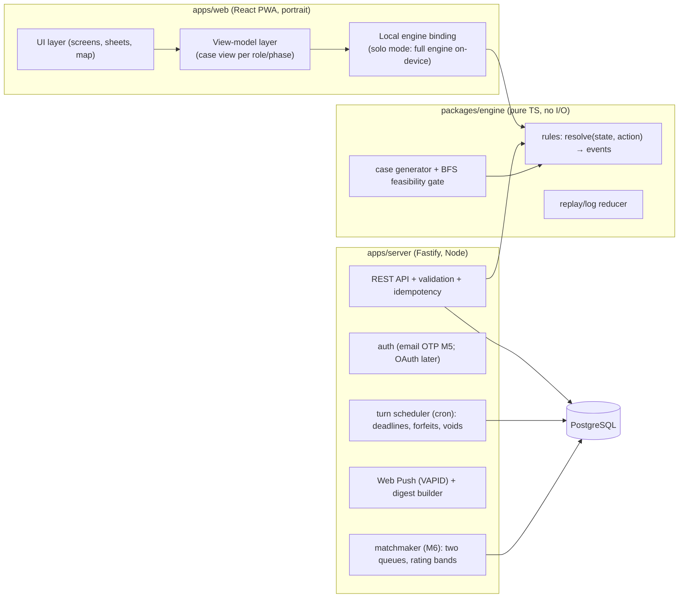

# 07 — Technical Architecture

**Status:** recommendation with rationale, pre-implementation. Constraints: solo developer, web-first portrait PWA, turn-based async (zero realtime), server-authoritative hidden information (once MP exists), future mobile packaging without rewrites.

## 1. Options considered

| Option | Description | Pros | Cons | Verdict |
|---|---|---|---|---|
| A. BaaS (Firebase/Supabase) | Managed DB + auth + functions | Fast to start; push infra free tier | Hidden-info server logic leaks into functions; engine reuse awkward; egress/query limits; two sources of truth (client engine vs functions) | Rejected |
| B. **TS monorepo + shared deterministic engine + small stateful API server** | `packages/engine` (pure TS rules), `apps/web` (React PWA), `apps/server` (Fastify + Postgres) | One engine = 4 consumers (client validation, server authority, simulation harness, replay); full test control; boring, debuggable infra | Solo dev operates a small server | **Recommended** |
| C. Realtime authoritative server (Colyseus/Nakama) | Room-based realtime netcode | Overkill today | No realtime requirement; ops cost; licensing; harder to sim headlessly | Rejected |
| D. Fully client-authoritative (P2P-ish, signed states) | No server hidden state | No backend | **FATAL**: hidden information is trivially cheatable (audit A12) | Rejected outright |

**Recommendation: Option B.** The deciding factor is the engine: Dead Drop's rules are a pure function `resolve(caseState, action) → events`. Building that once in TypeScript and sharing it kills the entire class of client/server rules drift, enables the M2 simulation harness for free, and makes replays trivial. The server is deliberately *boring*: REST + Postgres + cron + Web Push. No websockets, no queues beyond a cron worker, no Redis at MVP.

## 2. System boundaries

**Key boundary rule:** `packages/engine` has zero I/O and zero platform dependencies. The client uses it directly in solo (instant, offline-capable); the server uses it as the only authority in MP; the sim harness drives it headlessly; the replay viewer re-resolves historical actions through it.

## 3. Case lifecycle and state machines

```mermaid
stateDiagram-v2
    [*] --> PENDING: case created (solo: local; MP: server)
    PENDING --> FUGITIVE_TURN: day d begins
    FUGITIVE_TURN --> RESOLVING: move submitted (or deadline forfeit)
    RESOLVING --> INVESTIGATOR_TURN: stakeout/evidence/drop/escape resolved
    INVESTIGATOR_TURN --> FUGITIVE_TURN: actions submitted (or deadline), day < 8
    INVESTIGATOR_TURN --> COMPLETED: verdict set (CAPTURE / EXPIRY)
    FUGITIVE_TURN --> COMPLETED: verdict set (ESCAPE)
    FUGITIVE_TURN --> FORFEITED: 2nd consecutive missed deadline (F)
    INVESTIGATOR_TURN --> FORFEITED: 2nd consecutive missed deadline (I)
    PENDING --> VOIDED: mutual abandonment / unclaimed match
    COMPLETED --> [*]
    FORFEITED --> [*]
    VOIDED --> [*]
```

- **RESOLVING is atomic and server-side (MP):** the engine applies the Fugitive's action and immediately evaluates steps 2–5 (stakeout, evidence, drop, escape) — the client only ever sees the resulting *view*, never the transition inputs of the hidden side.
- **Solo mode:** the same state machine runs locally; "PENDING→" transitions happen synchronously. Solo cases sync to the server only when accounts exist (M5), as whole-case records (they contain no competitive integrity surface).

## 4. Data model (core tables, M5+; MVP stores solo cases locally in IndexedDB)

| Table | Key fields | Notes |
|---|---|---|
| `players` | `id (uuid)`, `handle`, `created_at`, `locale`, `timezone` | no email at rest until M5 auth (then `auth` table) |
| `cases` | `id`, `mode (solo/casual/ranked)`, `map_id`, `ruleset_version`, `config_json` (public), `seed`, `state_json` (server-authoritative incl. hidden), `verdict`, `phase_deadlines` | `state_json` contains the hidden route — access-controlled (08-api-security §3) |
| `case_actions` | `id`, `case_id`, `seq`, `actor (F/I/system)`, `action_json`, `idempotency_key (unique)`, `events_json` (public events only for I-facing log) | append-only; the case *is* the action list + config (replayable) |
| `matches` (M6) | `id`, `case_id`, `player_i_id`, `player_f_id`, `rating_delta_i/f` | rating history |
| `ratings` (M6) | `player_id`, `role (I/F)`, `glicko_json`, `games_played` | two rows per player |
| `queue` (M6) | `player_id`, `role`, `enqueued_at` | consumed by matchmaker cron |
| `notifications` | `player_id`, `type`, `payload_json`, `sent_at` | digest grouping |
| `anomaly_flags` (M6) | `case_id`, `flag_type`, `score`, `reviewed` | post-case only (A12) |

- **Migrations:** versioned, forward-only (`drizzle-kit` or Prisma Migrate — decision at M5, either is fine; no ORM lock-in concerns at this scale).
- **IDs:** UUIDv7 (time-ordered) for all entities; node IDs remain stable strings from map data (`D2-07`), never integer indices — maps are content, not schema.
- **Versioning:** `cases.ruleset_version` + `cases.map_id` make every historical case self-describing; the engine package is semver-tagged and old majors are kept runnable for replay (small cost, big trust win).

## 5. Async turn submission & resolution

1. Client submits action (`POST /cases/:id/actions`, Idempotency-Key header).
2. Server validates: auth → case phase/actor → deadline → action legality (engine, read-only) → budget.
3. Server applies the action **transactionally** (`SELECT ... FOR UPDATE` on the case row): engine `resolve()` → events → persist `case_actions` + new `state_json` → compute next deadlines.
4. Response: the *role-scoped case view* (§ role-scoped views in 08-api-security).
5. Cron worker (every minute): scans `phase_deadlines` → sends T-6h/T-3h reminders → applies miss/forfeit/void transitions → enqueues pushes. Cron idempotency via `notifications` unique constraints.
6. Fugitive path secrecy: the Fugitive's move is applied inside step 3 and *never* echoed to the Investigator-facing log; only derived public events (reveals, drop completions) and verdicts cross the wall.

## 6. Notifications, matchmaking, authentication, persistence, recovery

- **Notifications:** Web Push via VAPID (works for installed PWAs on Android/desktop; iOS PWA push requires iOS ≥ 16.4 install flow — documented limitation, acceptable for web-first; native wrappers get FCM/APNs later). Digest builder groups events per player per day.
- **Matchmaking (M6):** two FIFO queues (Investigator/Fugitive) scanned by cron; pair cross-queue when ratings within ±100 (04-balance-sim P13); create case with fresh seed; both players receive "Case opened" push. No realtime presence required.
- **Auth (M5):** email one-time-code (magic link) minimum; Apple/Google Sign-In added before store packaging (store rules). Solo (MVP) requires **no account**.
- **Persistence & recovery:** Postgres is the only source of truth for MP; point-in-time recovery enabled; daily logical backups. Client caches last case view (IndexedDB) for offline reading; all submissions are queued with idempotency keys and replayed on reconnect.
- **Solo offline:** the engine runs in the client; a solo case is fully playable offline and syncs as a complete record later. MP is online-only by design (deadlines are server-enforced).

## 7. Testing, observability, security, privacy, deployment

- **Testing:** 09-testing.md. The engine is the primary test surface (pure functions).
- **Observability:** structured JSON logs with `case_id`/`request_id` correlation; Sentry (client + server); minimal metrics (case transitions/day, forfeit rate, cron lag, p95 API latency). No dashboards beyond the free tiers — solo-dev ops budget.
- **Security/privacy:** 08-api-security.md (hidden-info walls, auth, rate limits, GDPR posture).
- **Deployment:** single small VM (or Fly.io/Railway) running `apps/server` + Postgres; static PWA on any CDN (Netlify/Cloudflare Pages); GitHub Actions CI (lint, typecheck, engine tests, sim smoke); staging environment = same stack, seeded data. No Kubernetes, no microservices — the scale (thousands of cases/day) never justifies it.

## 8. Future mobile compatibility

- The PWA is built portrait-fixed with safe-area insets from day one; Capacitor wrap (post-MVP) needs: push provider swap (FCM/APNs), store-compliant auth providers, and a shell — no engine or UI rewrite. This is the reason React (DOM) is chosen over a game engine: Dead Drop is a *map + forms* app, not a physics app; a canvas/game-engine stack would add complexity with no payoff (deliberate rejection of Unity/Godot for this product).
