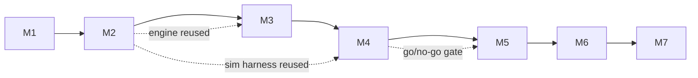

# 10 — Roadmap, Milestones & Scope Fences

**Status:** plan. Assumption: one developer, part-time (nights-and-weekends). Durations are planning estimates, not commitments; every milestone ends in an explicit **exit condition** — if it can't be met, the milestone is not done, whatever the calendar says.

## 0. Scope fences (normative)

**MVP (M1–M4):** deterministic rules engine; 1 map; case generator + feasibility gate; 24-case solo ladder; 3 AI Fugitive archetypes + baseline AI Investigator; tutorial (2 scripted cases); manual belief markers; solo assist heatmap; skill tiers (on-device); replay/log viewer; simulation harness + balance report; analytics (privacy-preserving). **No server, no accounts, no MP, no ads.**

**Post-MVP (M5–M7):** accounts/auth; turn server + Postgres; Web Push; casual async; matchmaker + two rated ladders (Glicko-2); anomaly flags; cosmetics + capped ads/offers (solo/casual only); store packaging via Capacitor; second map; 3-drop "Grand Tour" cases.

**Rejected / do not build (with reasons):**

| Feature | Verdict | Reason |
|---|---|---|
| Client-authoritative hidden state | Rejected | Cheating trivial (audit A12) |
| Hidden per-player difficulty adaptation in PvP | Rejected | Rigging perception is fatal (A8) |
| Purchasable information/power; random paid items | Rejected | Pay-to-win + store odds-disclosure exposure (A11) |
| Auto-heatmap outside solo | Rejected | Solves the game (A7) |
| Investigator agent movement / node blocking | Rejected for v1 | Different game; big balance surface; revisit only with new design work |
| Realtime mode / chat | Rejected | Conflicts with identity + moderation cost |
| Disclosed ranked handicaps | Deferred (data-gated) | Right idea, no data yet (Q3) |
| User-generated cases | Rejected indefinitely | Balance + collusion surface |
| Vacation mode | Deferred | Forfeit rules cover MVP; revisit with real abandonment data |

## 1. Milestones

### M1 — Requirements & design validation (2–3 wks)

| Field | Detail |
|---|---|
| Goal | Prove the ruleset is complete, teachable, and playable *on paper* before any code |
| Tasks | 1. Finalize doc set (this release) · 2. Paper-prototype kit (print map, tokens) · 3. Play 3 full cases both roles with 2 different partners · 4. Log every rule dispute → patch 03-rules.md · 5. Freeze ruleset v1.0-alpha |
| Dependencies | None |
| Deliverables | Frozen rules doc; paper-playtest notes; v1.0-alpha tag |
| Acceptance | Every §9 edge case has a ruling; no "TBD" left in 03-rules.md; both roles completed ≥3 cases each on paper |
| Risks | Rules feel flat on paper (no UI scaffolding) — acceptable; note feelings, don't tune yet |
| **Exit** | Ruleset frozen + paper findings logged |

### M2 — Rules engine & mathematical simulation (3–4 wks)

| Field | Detail |
|---|---|
| Goal | Engine as pure TS package + sim harness + balance report v1 |
| Tasks | 1. `packages/engine`: types, resolve(), generator + BFS gate · 2. L1/L2 test suites (09-testing §2 list) · 3. Sim harness + 20 policy-pair matrix · 4. Sensitivity sweeps S1–S7 · 5. Balance report + retune list; apply ≤1 parameter pass · 6. Version-tag engine |
| Dependencies | M1 frozen ruleset |
| Deliverables | `engine@1.0.0-alpha`; sim report (Wilson CIs); retuned parameter table v1.1 if warranted |
| Acceptance | G1 (01-prd §8): L1 green; role win-rate in band or specific retune list; determinism green over 10k seeds |
| Risks | Reveal schedule wrong → S2 readout; sim policies too weak to expose dominance → add `I-Calendar` variants |
| **Exit** | G1 signed off in 14-readiness |

### M3 — Playable single-player prototype (4–5 wks; W1 executed 2026-10-26 — apps/web scaffold + playable Investigator loop + Stage-1 F-Planner AI, ADR-005; next: W2 archetypes + ladder + IndexedDB replay)

| Field | Detail |
|---|---|
| Goal | Web PWA: tutorial + 24-case solo ladder, playable end-to-end |
| Tasks | 1. `apps/web` scaffold (portrait shell, map renderer) · 2. Case screens both roles (S2/S3/S4) + belief markers · 3. AI stages 1–2 (05-ai-spec) · 4. Tutorial scripts · 5. Local persistence (IndexedDB) + replay viewer (S6) · 6. Skill tiers on-device · 7. Analytics events + Sentry · 8. Internal dogfood (5 testers) |
| Dependencies | M2 engine |
| Deliverables | Installable PWA; 24-case ladder; replay viewer |
| Acceptance | G2: L5 pass; tutorial completion ≥70% internal; zero known rule bugs; crash-free ≥99% |
| Risks | Map UI eats the schedule (renderer scope creep) — mitigation: vector map with fixed layout, no art polish pass until M4 |
| **Exit** | G2 signed off |

### M4 — Balance & usability testing (3–4 wks, overlaps M3 polish)

| Field | Detail |
|---|---|
| Goal | Validate fun, fairness, difficulty bands with humans; publish parameter v1.1 |
| Tasks | 1. Recruit 15–20 playtesters · 2. Run protocol (04-balance-sim §7): telemetry + surveys + 6 think-alouds · 3. Rerun sim with playtest-informed variants · 4. Tune v1.1 (≤1 pass, logged) · 5. Build+flag the solo adaptive director (stage 4) if data supports · 6. Written findings |
| Dependencies | M3 build |
| Deliverables | Playtest report; parameters v1.1; director behind flag |
| Acceptance | G3: playtest complete; honest fun-gate result; v1.1 diff log published |
| Risks | Fun gate fails → *this is a stop line, not a speed bump*: diagnose (role? pacing? info volume?) before M5 spend |
| **Exit** | G3 signed off; go/no-go decision for MP recorded |

### M5 — Asynchronous multiplayer (5–6 wks)

| Field | Detail |
|---|---|
| Goal | Casual async works: accounts, turn server, pushes, deadlines |
| Tasks | 1. `apps/server` (Fastify+Postgres) + engine-as-authority · 2. Auth (email OTP) · 3. Case lifecycle + role-scoped views (info-wall tests) · 4. Cron scheduler (deadlines/forfeits/void) · 5. Web Push + digest · 6. Casual lobby + invite tokens · 7. L4 integration suite + load spike on cron · 8. Closed beta (G4 metrics) |
| Dependencies | M3/M4 client; G3 pass |
| Deliverables | Server + casual MP; beta report |
| Acceptance | G4: completion ≥70%, forfeit ≤15%, push opt-in ≥60%; info-wall test green (100% required) |
| Risks | iOS PWA push quirks (R9) — device spike first; solo-dev ops burden — runbook + Sentry alerts from day 1 |
| **Exit** | G4 signed off |

### M6 — Ranked play & production readiness (4–5 wks)

| Field | Detail |
|---|---|
| Goal | Two rated ladders, matchmaking, integrity tooling, production ops |
| Tasks | 1. Glicko-2 per role · 2. Two-queue matchmaker (±100) · 3. 12 h clocks + season scaffold · 4. Anomaly flags (post-case) + review dump · 5. Ops: backups/PITR, uptime alerts, runbook · 6. Open beta → harden |
| Dependencies | M5 |
| Deliverables | Ranked live (beta→prod); ops runbook |
| Acceptance | G5: flags <2% of cases; uptime ≥99%/30 days; matchmaking p50 <24 h |
| Risks | Population too small for ±100 bands early — mitigation: widen to ±200 with disclosed band, tighten as population grows |
| **Exit** | G5 signed off |

### M7 — Monetization & post-launch (3–4 wks + ongoing)

| Field | Detail |
|---|---|
| Goal | Sustainable, trust-clean monetization + live-ops baseline |
| Tasks | 1. Cosmetics (map skins, dossier frames — zero gameplay surface) · 2. Rewarded ads: solo continue + casual +1 probe, ≤3/day, solo/casual only · 3. Offers (behavior-segmented, never mid-win-streak) · 4. Store packaging (Capacitor; store auth providers) · 5. Privacy review + store review · 6. Live-ops: weekly case seeds, season calendar |
| Dependencies | M6; privacy posture (08-api-security §6) |
| Deliverables | v1.0 store release; monetization live; live-ops calendar |
| Acceptance | G6: automated check — ranked flow contains zero ad surfaces; caps enforced; reviews pass |
| Risks | Ads damage perception even in casual → measure sentiment; cosmetics-only fallback is the safe floor |
| **Exit** | G6 signed off; v1.0 shipped |

## 2. Critical path & dependency graph

Total planning estimate: **22–31 weeks** part-time. The gate that matters most is **M4→M5**: no multiplayer money or time is spent before the game is proven fun solo.

## 3. Where the roadmap may legitimately change

- If M2 sims show the 2-drop shape lacks depth, the *content* fix (widen drop pool, 3rd safehouse) precedes the *rules* fix (3-drop/10-day format) — rules churn is the last resort because it invalidates playtests.
- If M4 shows Investigators starve for information, the first lever is the reveal schedule (content-ish), the second is IP budget, the third is a new action — in that order.
